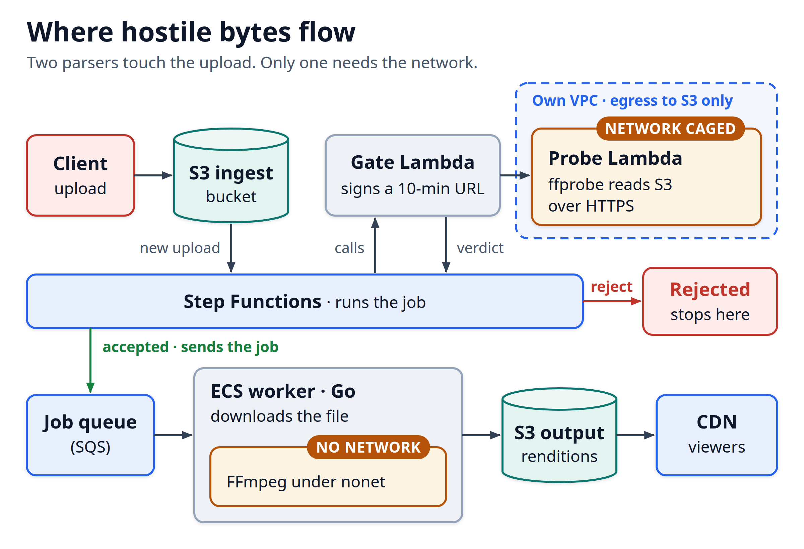

# ffmpeg-sandbox

A small, runnable mimic of the transcoding worker from Part 1,
**"Every Upload Is an Exploit Attempt: Sandboxing FFmpeg on AWS."** It is the
code you can clone and run after reading the article, so the controls stop being
prose and start being binaries you can poke at.

The premise: treat every uploaded video as hostile. FFmpeg, ffprobe, and Shaka
Packager parse attacker-controlled bytes, so they run with no ability to open a
socket. This repo is that sandbox, plus the probe gate and the self-test that
keep it honest.



## What's here, and what it proves

Everything below was built and run on Linux 7.0, gcc 13, Go 1.27, ffmpeg 9.0.2:

- **`nonet`** (`sandbox/nonet.c`) is a ~800 KB static seccomp-BPF exec helper. It
  denies `socket()` for every family (AF_UNIX included), `socketpair()`,
  `io_uring_setup`, any foreign ABI (i386 `int 0x80`, x32) and process creation
  (`clone` is allowed only for threads), then execs the real tool. Every denial
  returns an error (`EACCES`, or `ENOSYS` for `clone3`), not a kill, so the tool's
  own exit codes survive. It also closes
  inherited fds above the progress pipe before exec.
- **The worker** (`worker/`, Go) ties the article together. It marks itself
  non-dumpable (`PR_SET_DUMPABLE(0)`), starts every media tool with an empty
  environment, and is a child subreaper. `nonet` already stops a tool starting a
  process, so as a backstop, after each tool exits, the worker kills and reaps
  anything left running and fails the run as hostile input.
  - `selftest` runs the startup gate: each tool starts under `nonet`, a sample job
    goes through the real `transcode` path (input guards, `nonet`, fd 3
    telemetry), and `socket_probe` confirms `socket()`, `socketpair()`, `fork()`
    and `clone()` are denied (exit 42). Any unexpected outcome, a leftover process
    included, fails closed.
  - `probe` runs the probe gate: `-protocol_whitelist file`, `-format_whitelist`,
    `-codec_whitelist`, `-max_pixels`, `-max_streams 33` and `-max_alloc`, then
    app-logic checks on the parsed JSON. It rejects more than 32 streams, because
    Matroska and MPEG-TS stop at the cap and still exit 0. It checks the codecs of
    the first video stream that isn't cover art and of the first audio stream
    against a codec table (`worker/probe.go`), which also builds the decoder-name
    whitelist: AV1 decodes as `libdav1d`, MP3 as `mp3float`, and LPCM is allowed
    for OBS lossless audio. Then the dimensional checks. A probe past its 20 s
    deadline is `Probe.Transient`; every other refusal is `Probe.Rejected`. The
    probe runs without `nonet`, so its leftover kill is its only cleanup.
  - `transcode` runs ffmpeg under `nonet` with the same input flags (file and pipe
    protocols), maps exactly the streams the probe checked, runs in its own
    process group (so a timeout kill hits ffmpeg, not the worker), and reads
    `-progress` telemetry off fd 3 with a 5 s bound after exit, then classifies
    the result.
- **The test harness** (`test/`) reproduces the article's evidence: the socket
  vectors (`bypass_test.c`), the process-creation vectors (`fork_test.c`), the
  `/proc/1/environ` read (`envtest.sh`), the `PR_SET_DUMPABLE(0)` block
  (`dumpable_proof.c`), the fd cleanup
  (`fd_probe.c`, `fd_test.sh`) and the `max_pixels` exit-code trap
  (`exit_code_test.sh`).
- **The network side** (`deploy/`) is documentation, not code. The Lambda probe
  needs the network, so AWS controls protect it instead of `nonet`: a VPC of its
  own with S3-only egress, a DNS Firewall allow-list, and a gate Lambda that signs
  the URL so the probe's own role holds no S3 permission. See the caveats below.

## Quickstart

You need `gcc`, `make`, Go 1.27+, and ffmpeg/ffprobe built with libx264 (9.0.2
to match the article). No AWS, and Docker is optional.

```bash
# Point at ffmpeg 9.0.2 if it isn't your PATH default:
export FFMPEG=/path/to/ffmpeg FFPROBE=/path/to/ffprobe

make build          # -> bin/nonet, bin/socket_probe, bin/bypass_test,
                    #    bin/fork_test, bin/dumpable_proof, bin/fd_probe, bin/worker
make selftest       # the startup gate; should end "PREFLIGHT OK"
make isolation      # bypass_test and fork_test with and without nonet, then the
                    #    fd test; fails if anything opens or starts under nonet
make fdtest         # the fd test alone: fds above 3 closed, fd 3 kept
make proofs         # PR_SET_DUMPABLE and the max_pixels exit code
make strict         # every C source under -std=c11 -Wall -Wextra -Werror
```

Or run the whole thing, including a real probe and transcode, in one shot:

```bash
./scripts/run-local.sh
```

### In Docker (closest to the ECS worker)

```bash
make docker
docker run --rm \
  --cap-drop ALL \
  --security-opt no-new-privileges \
  --read-only \
  --user 1000:1000 \
  --ipc none \
  --sysctl kernel.shmmni=0 \
  --sysctl kernel.msgmni=0 \
  --sysctl "kernel.sem=0 0 0 0" \
  --sysctl fs.mqueue.queues_max=0 \
  --tmpfs /scratch:rw,nosuid,nodev \
  ffmpeg-sandbox-demo selftest
```

The hardening (`--read-only`, `--cap-drop ALL`, non-root, no-new-privileges, and no
`/dev/shm` or IPC objects) comes from those run flags. On ECS the task definition
sets the same things: `readonlyRootFilesystem`, `user`, dropped capabilities,
`no-new-privileges` through `dockerSecurityOptions` (EC2 launch type only), and
`ipcMode: none` with the four IPC `systemControls` set to 0. Without the IPC
settings, a hijacked tool could leave shared memory or message queues behind for
the next job. The media tools use neither. The rootfs is read-only, so the
smoke job needs a writable scratch: the image sets `TMPDIR=/scratch` and the run
mounts a tmpfs there. `nonet` stacks its filter on top of Docker's default seccomp
profile at runtime. The image uses Alpine's FFmpeg 6.1.1 to stay self-contained;
the article's numbers come from the pinned 9.0.2 static build.

To reproduce the article's before/after socket output in the same hardened
container:

```bash
docker run --rm --cap-drop ALL --security-opt no-new-privileges --read-only \
  --user 1000:1000 --ipc none --sysctl kernel.shmmni=0 --sysctl kernel.msgmni=0 \
  --sysctl "kernel.sem=0 0 0 0" --sysctl fs.mqueue.queues_max=0 \
  --entrypoint bypass_test ffmpeg-sandbox-demo
docker run --rm --cap-drop ALL --security-opt no-new-privileges --read-only \
  --user 1000:1000 --ipc none --sysctl kernel.shmmni=0 --sysctl kernel.msgmni=0 \
  --sysctl "kernel.sem=0 0 0 0" --sysctl fs.mqueue.queues_max=0 \
  --entrypoint nonet ffmpeg-sandbox-demo bypass_test
```

The baseline opens every socket family but Docker blocks `io_uring_setup`.
Under `nonet` every one returns "Permission denied".

## Command reference

```
worker tools                    show which binaries were resolved
worker selftest                 startup self-tests
worker probe <file>             probe gate on a local file
worker transcode <in> <outdir>  transcode under nonet to a 720p rung
```

Binary resolution, in order: the matching env var (`$NONET`, `$SOCKET_PROBE`,
`$FFMPEG`, `$FFPROBE`, `$PACKAGER`), then `$SANDBOX_BIN` (or the worker's own
directory), then `PATH`.

## Layout

```
sandbox/   nonet.c, socket_probe.c        the seccomp helper and preflight probe
worker/    main, sandbox, preflight,      the Go worker (selftest / probe / transcode)
           probe, transcode
test/      bypass_test.c, fork_test.c,      the reproducible evidence
           dumpable_proof.c, fd_probe.c, fd_test.sh,
           exit_code_test.sh, envtest.sh,
           isolation.sh
deploy/    AWS-CONTROLS.md, *.json         the Probe Lambda network controls (docs)
docs/      THREAT-MODEL.md                 the layer matrix + what is/ isn't proven
           DEEP-DIVE.md                    the edge cases cut from the article
           img/                            the pipeline and nonet diagrams
Dockerfile, Makefile, scripts/run-local.sh
```

## Caveats, stated plainly

- **The AWS controls in `deploy/` are documented configuration, not code.** I run
  this network isolation (S3 gateway endpoint, security-group prefix list,
  Route 53 DNS Firewall) and the gate Lambda in production, but they rest on AWS
  service behavior, so nothing in this repo can exercise them, and there is no
  Terraform here. Wire your own IDs.
- **Shaka Packager is optional.** It is not in Alpine's package set, so the demo
  skips its checks unless you install it and set `PACKAGER`. The tempfile trap
  (`--temp_dir` on a writable mount, because `/tmp` is read-only) is still
  documented and exercised when packager is present.
- **The probe runs ffprobe directly, not under `nonet`,** because the real probe
  needs the network to reach S3. On a local file it uses the `file` protocol; in
  production the protocol whitelist is `https,tls,tcp` with `-ca_file` for the S3
  byte-range requests. Same resource ceilings either way.
- **`make isolation` runs on the host,** where there is no Docker default seccomp
  profile, so the baseline shows `io_uring_setup: OPENED`. Inside the container
  it shows "Operation not permitted". Under `nonet` both become "Permission
  denied". See `docs/THREAT-MODEL.md`.
- **Where the demo is simpler than the design** (the design is in the article
  and `deploy/AWS-CONTROLS.md`):
  - one 720p rung with a fixed 2-minute timeout, where the design scales the
    deadline to the probed duration;
  - no duration bounds at the probe, where the design rejects anything outside
    0.5 to 362 s;
  - the first audio track, where the design picks the default-disposition track
    and the probe checks that same one;
  - the full static FFmpeg build, which refuses files with subtitle tracks or
    cover art at the probe, because ffprobe opens a decoder for every stream and the
    whitelist refuses those decoders. A minimal build leaves them out, so ffprobe
    skips those streams and the design accepts the file;
  - no `Probe.Fault`, which in the design is a crashed or frozen Probe Lambda and
    has no local stand-in;
  - no circuit breaker, so a 234 is reported, not re-checked against a sample;
  - one job per `worker` run, so no scratch wipe between jobs, and `selftest`
    doesn't check the IPC settings, where the design's boot self-test does.

## License

MIT. See [LICENSE](LICENSE); edit the copyright holder to suit.
