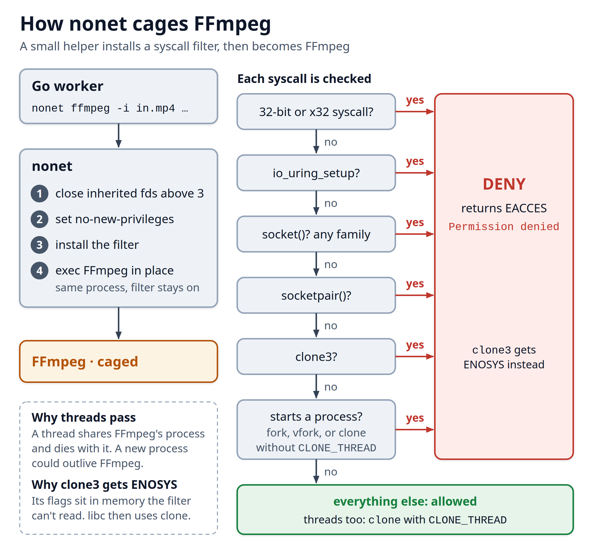

# Deep dive: the details cut from the article

The article keeps to the main line of the argument. This file holds the edge cases
and evidence behind the worker sandbox, one section each. Each claim was tested
locally or comes from a source listed at the end, except where it says
inference. The Probe Lambda's AWS controls live in
[`../deploy/AWS-CONTROLS.md`](../deploy/AWS-CONTROLS.md).

## Why the protocol allow-list is not the boundary

`-protocol_whitelist file` still allows local file reads. Once a stage needs
`https`, a playlist can point FFmpeg at any HTTPS address the network allows.

On their own, FFmpeg 9.0.2's demuxer defaults catch the obvious attempts:

```text
Not detecting m3u8/hls with non standard extension and non standard mime type
[hls @ ...] URL file:///etc/hostname is not in allowed_segment_extensions, ...
[concat @ ...] Unsafe file name '/etc/hostname'
```

These are internal checks (`allowed_segment_extensions` in `hls.c`, `-safe 1` in
`concatdec.c`). One bug in either, or a second parser chained in front, and they
fall away. `-format_whitelist mov,matroska,avi,mpegts` removes the `hls` and
`concat` demuxers entirely. The short names cover more than they look: `mov`
matches `mov,mp4,m4a,3gp,3g2,mj2`, `matroska` covers MKV and WebM, and still
images (`png_pipe`, `jpeg_pipe`, `gif`) are refused at header detection.

## More history: VK.com and VobSub

- VK.com (2017, HackerOne #226756). Emil Lerner and Pavel Cheremushkin showed
  that an AVI with embedded GAB2 subtitle chunks could reach the HLS demuxer and
  render local files into video frames through the XBIN codec.
- CVE-2026-64830. This is a heap overflow in the VobSub subtitle demuxer
  (`libavformat/mpeg.c`, FFmpeg 2.1 to 8.1.2, CVSS 4.0 score 8.7). It is a good example of
  what a format allow-list removes for free, because VobSub isn't on the list.

## CVE-2026-39210, stated carefully

depthfirst describes it as a 2010 bug in the MPEG-TS demuxer that lacked a length
check before reading two bytes. On CVE.org it is still RESERVED, and NVD and OSV
have no entry. Upstream commit `5975149603ba` ("avformat/mpegts: Check
IOD_DESCRIPTOR len") fixes an out-of-array read in that demuxer and is in `n9.0.2`.
Linking that commit to the CVE is my inference from timing and location, not an
advisory. Either way, the point stands. `mpegts` has to be accepted, and the next
bug in it is not found yet.

## The codec table: decoder names, codec names, and missing decoders

FFmpeg checks `-codec_whitelist` against the decoder's implementation name, not
the codec (`av_match_list(codec->name, ...)` in `libavcodec/avcodec.c`). It picks
`libdav1d` for AV1 and `mp3float` for MP3, so a list that says `av1,mp3` rejects
every AV1 file and every file with MP3 audio. ffprobe's JSON, on the other hand,
reports codec names. `worker/probe.go` keeps one table of codec name to decoder
name and builds both from it: the whitelist, and the probe's own check.

That check exists because of a second trap. ffprobe opens a decoder for every
stream. If the decoder is compiled in and the whitelist refuses it, ffprobe exits
1. If the decoder isn't compiled in at all, ffprobe prints a warning and skips the
stream (`fftools/ffprobe.c` n9.0.2, `open_input_file`). So on a minimal build, a
codec outside the build passes ffprobe and fails later, in the worker, with 234.
Tested on a minimal 9.0.2 build: an iPhone Live Photo (PCM audio, no PCM decoder
in that build) probed clean, then ffmpeg failed with "Decoding requested, but no
decoder found". The probe therefore checks the codec of each stream the worker
will decode. On a minimal build, an MP2 or ProRes file now fails as "unsupported
audio codec mp2" or "unsupported video codec prores". This demo's full build
refuses it a step earlier, at ffprobe's whitelist.

The same mechanism decides subtitles and cover art:

| File | Full build (this demo) | Minimal build |
|---|---|---|
| subtitle track (SRT, ASS, WebVTT, mov_text) | probe exits 1 | passes, the track is ignored |
| cover art (JPEG, PNG) | probe exits 1 | passes, the picture is skipped |
| timecode, chapters, GoPro and phone metadata tracks | pass | pass |

The worker maps `0:V:0`, the first video stream that isn't cover art, and one
audio stream, so the tracks the probe ignores are never decoded. LPCM
(`pcm_s16le`, `pcm_s24le`, `pcm_f32le`) is on the table, because OBS records
lossless audio with exactly those encoders.

## One stream past the cap

`-max_streams 32` doesn't make every container fail. Measured on 9.0.2 with 32,
33 and 34-stream files:

- MP4 and AVI fail hard past the cap.
- Matroska and MPEG-TS stop adding streams at the cap, exit 0 and report exactly
  32. A 33-stream MKV then fails later in the worker, and a TS can encode with
  streams silently dropped.

So every call passes `-max_streams 33`, and the probe rejects any file that
reports more than 32. Every 33- and 34-stream file is then rejected in all four
containers, and 32-stream files still pass.

## Foreign ABIs: i386 and x32



On x86-64, code can still make 32-bit syscalls with `int 0x80`. There, `socket()`
has a different number: historically `socketcall` (102), and since Linux 4.3 a
direct `socket` at 359, which `test/bypass_test.c` uses. A filter that checks only
the x86-64 number (41) misses both. The x32 ABI sets bit 30 (`0x40000000`) in the
syscall number. `nonet` denies any foreign architecture and any x32 call.

## Why the filter denies `socketpair()` too

Two families implement `socketpair()` in Linux, `AF_UNIX` and `AF_TIPC`
(`net/unix/af_unix.c`, `net/tipc/socket.c`). Both give a sandboxed tool something
`socket()` was meant to take away:

- An `AF_UNIX` datagram pair can `sendto()` any bound datagram socket by path. I
  tested it under `nonet` before the change: `socket(AF_UNIX)` was denied, the
  pair opened, and a message reached a socket bound outside the sandbox. A log
  socket mounted into the container would be reachable that way.
- `__sys_socketpair` creates both sockets with `sock_create()` before it asks
  whether the family supports pairs (`net/socket.c`), and creating a socket for an
  unloaded family calls `request_module("net-pf-%d")`. So a pair request can load
  the tipc module, with no capability needed. TIPC has a history of serious bugs.

Docker's default profile filters `socket()` by family, but allows `socketpair`
unfiltered. FFmpeg, ffprobe and Shaka Packager 3.9.3 make no `socketpair` call
(strace), so denying it costs nothing.

## Killing FFmpeg, not the worker, on timeout

`exec.Command` puts the child in the worker's process group by default, so killing
"the group" would hit the worker too. The worker sets `Setpgid: true`, `nonet`
execs FFmpeg in place, and FFmpeg leads its own group. A timeout then sends
`SIGKILL` to `-pid`, which reaches FFmpeg and anything it forked that stayed in
the group (`worker/sandbox.go`). A child that calls `setsid` leaves the group, so
the next section covers it.

## Processes a hijacked tool leaves behind

A hijacked FFmpeg could start `setsid sleep 300 &` and exit. Nothing kills a child
after a clean exit, and `setsid` takes it out of the process group, so even the
timeout's group kill misses it. On a long-lived worker it would sit beside the next
uploads' files.

`nonet` stops it at the start. FFmpeg, ffprobe and Shaka never start a process, so
the filter allows `clone` only with `CLONE_THREAD` and denies `fork`, `vfork` and
every other `clone`. `clone3` passes its flags in memory the filter can't read, so
it gets `ENOSYS` and libc falls back to `clone`. Chromium's baseline seccomp
policy also allows `clone` only for threads and returns `ENOSYS` for `clone3`. Under `nonet`, `fork`, `vfork`, raw `clone`, `clone3` and
`posix_spawn` all fail and threads still start (`test/fork_test.c`, run by
`make isolation`). The startup self-test checks it too: `socket_probe` also tries
`fork()` and a raw `clone()`, since musl's `fork()` calls `SYS_fork` on x86-64.

The worker keeps a cleanup behind that, and the probe depends on it, because it
runs ffprobe without `nonet`. Two cleanups were tested in a hardened container as
uid 1000:

| Fix | Result | Catch |
|---|---|---|
| Worker as PID 1 runs `kill(-1, SIGKILL)` and reaps | leftover and a zombie gone in 0.43 ms | needs PID 1, and hits sidecars sharing the PID namespace |
| Worker is a child subreaper and kills its own children | leftover gone in 8.6 ms, PID 1 or not | must not reap a command still running |

The worker uses the subreaper. `prctl(PR_SET_CHILD_SUBREAPER)` makes every orphan
of its tools its own child instead of PID 1's. After each tool's `Wait`, the
worker finds its children in `/proc`, kills them and reaps them by pid, never with
`wait4(-1)`, which would steal another command's exit status. A `/proc` it can't
read fails the run rather than read as "no children". That holds on a `/proc`
without `hidepid`, which Docker never sets: with `hidepid=invisible`, a leftover
that marks itself non-dumpable drops out of the listing with no error. It does this before it
drains the progress pipe, because a leftover can hold fd 3 open. Go's `WaitDelay`
closes only the pipes `os/exec` creates, not `ExtraFiles`, so the drain also gets
a 5 s read deadline as a backstop.

A leftover means the sandbox failed, or on the probe that ffprobe was hijacked.
The run fails as hostile input and the output is deleted, even when the tool
exited 0 and wrote a plausible file. Try both stages with a fake tool:

```bash
printf '#!/bin/sh\nsetsid sleep 30 &\nexit 0\n' > /tmp/fake && chmod +x /tmp/fake
FFMPEG=/tmp/fake ./bin/worker transcode in.mp4 out
# verdict: FAILED (exit 2)     <- under nonet the shell can't fork
FFPROBE=/tmp/fake ./bin/worker probe in.mp4
# Probe.Rejected: ffprobe left 1 process(es) running (hostile input)
```

As PID 1, the worker also adopts orphans that no tool made, such as the child of a
shell-form health check that timed out, or an ECS Exec session's. It would read
them as a hijack. So the container health check is exec-form and forks nothing,
and worker tasks keep ECS Exec off.

## Why the filter denies AF_UNIX too

The first prototype allowed `AF_UNIX` as a precaution. A real encode and a real
package job under `nonet` opened no sockets of any family, so the filter now
denies every family. Older test logs from that prototype still show
`AF_UNIX: OPENED`.

## The `max_pixels` exit-code trap

`-max_pixels` is a decoder check. It fires when a decoded frame is too big, so the
probe fails with no dimensions to read instead of returning large ones:

```text
[h264 @ ...] Picture size 7680x4320 exceeds specified max pixel count 9437184
```

Measuring it is easy to get wrong. `ffmpeg ... | head` reports `head`'s exit code,
not FFmpeg's. Measured directly, the over-cap decode exits 234 with no output
(`test/exit_code_test.sh`).

## The two-call probe

The production probe makes two ffprobe calls over HTTPS. Call A reads the header
(formats, streams, pixel formats, dispositions). Call B decodes the first 0.1 s of
the main video stream (`-select_streams V:0 -read_intervals "%+0.1"`), because
HDR10 and HLG metadata often lives in SEI messages on the frames, not in the
container header. That metadata matters for output correctness, which Part 2
covers. How the Probe Lambda is called, caged and cleaned up between videos is in
`deploy/AWS-CONTROLS.md`.

## Why non-dumpable is required, not optional

`nonet` takes away the network, but a hijacked FFmpeg still writes the output
video, and that video reaches the uploader and, through the CDN, every viewer.
Anything FFmpeg can read can be drawn into frames.

`nonet` does not filter `ptrace`. Docker's default seccomp profile allows
`ptrace`, `process_vm_readv` and `process_vm_writev` on kernels 4.8 and later.
Amazon Linux 2023 sets `kernel.yama.ptrace_scope = 0` through its
`elfutils-default-yama-scope` package, and Yama never gates `/proc/<pid>/environ`
anyway. On such a host, a hijacked FFmpeg running as the worker's uid can read the
worker's environment, attach to it, or read its memory through `/proc/<pid>/mem`,
where the SDK caches the real keys. `PR_SET_DUMPABLE(0)` on the worker makes these
fail; in Docker, `/proc/<ppid>/mem`, `process_vm_readv` and `PTRACE_ATTACH` were
tested. It also stops `pidfd_getfd`, which would copy one of the worker's open
sockets into the tool. Docker's default profile allows that call only with
`CAP_SYS_PTRACE` anyway.

Non-dumpable doesn't cover everything a process with the same uid may do. A
hijacked tool can still signal the worker or change its resource limits. That ends
the attempt early and the job retries, but it can't turn the attempt into a
success or hand the tool a key or a socket. The probe has the same limit
(`deploy/AWS-CONTROLS.md`, control 5).

Dumpable resets to 1 on every `execve`, so the worker sets it itself at start,
and it never reaches FFmpeg. That's also why one job per task matters. Two FFmpeg
processes for different uploads would share a uid and both be dumpable.

The flag protects only the worker. With an init process in front (`docker run
--init`, or ECS `initProcessEnabled`), PID 1 is the init, which holds the same
environment and stays dumpable, so `/proc/1/environ` is readable again. A sidecar
sharing the PID namespace (`pidMode: task`) is the same risk. So the worker runs
as PID 1 with no init and no shared PID namespace.

## The Shaka Packager tempfile trap

With an empty environment and a read-only root filesystem, Shaka Packager 3.9.3
exits 2 with a misleading parser error, because it buffers to `/tmp`:

```text
E demuxer.cc:381] Failed to process sample 256 5 (FILE_FAILURE): Cannot open file to write /tmp/packager-tempfile-1-c5a74dfbf35dfe5d-1
E mp4_media_parser.cc:1071] Failed to process the sample.
E mp4_media_parser.cc:338] Error while parsing MP4
```

Pass `--temp_dir` on the writable scratch mount. The startup self-test packages
its sample job's output for this reason, since `--version` would never hit it. The
media tools get no `TMPDIR` from the worker, so the flag is required on every
call.

## Rollout safety

A failed self-test exits the container before it reports healthy, so it never
takes a job. Whether ECS then stops the deployment depends on your setup. The
deployment circuit breaker rolls back only with `rollback` enabled, and it needs
the rolling-update deployment type and a previous completed deployment. A task
that reaches RUNNING before the container exits may not count in its first stage,
so pair it with a container health check. An EventBridge rule on stopped tasks
(`EssentialContainerExited`) is a cheap alert on top.

## Why the filter has to be per-process

The Go worker shares the container with FFmpeg and needs the network for S3 and
SQS. Any container-wide profile that denied `socket()` would break the worker.
On EC2, the only seccomp setting outside the task is the Docker daemon's default
profile (`/etc/docker/daemon.json`, set from user data or a custom AMI). It
replaces the built-in profile for every container on the host, the ECS agent
included, and ECS's `dockerSecurityOptions` has no seccomp option. A network
namespace for the media tools alone would work too, but Docker's default seccomp
profile allows creating one only with `CAP_SYS_ADMIN`, which the container drops.
In the hardened container,
`unshare(CLONE_NEWNET)` and `unshare(CLONE_NEWUSER | CLONE_NEWNET)` both return
`EPERM`. So the filter goes on the media tools alone, from inside, which is what
`nonet` does.

## What `nonet` does not stop

`nonet` is a deny-list. It blocks the syscalls that reach the network and allows
the rest, because an allow-list of every syscall FFmpeg and libc need breaks on
updates. The cost is that a kernel bug reachable through an allowed syscall is
still reachable. On EC2 there is no isolation between tasks on one host, so an
escape can reach other tasks' credentials and the instance role. Keep the kernel
patched and run only tasks of the same trust level together.

Detection is a gap too. `EACCES` keeps FFmpeg's exit codes useful, but it also
makes a blocked `socket()` silent. A media tool calling `socket()` at all is a
strong sign of compromise, and nothing here alerts on it. A blocked `fork()` is
silent the same way. A leftover process (above) is the one hijack signal the
worker does act on.

## What the filter costs

Nothing measurable on a real transcode. A 20 s 1080p60-to-720p x264 job averaged
7.19 s plain and 7.18 s under `nonet` over 5 alternating runs, inside the
run-to-run noise. Since Linux 5.11 the kernel caches "always allowed" verdicts per
syscall number. For `nonet`'s filter alone that covers every syscall except the
ones it checks: `socket`, `socketpair`, `io_uring_setup`, `clone`, `clone3`, and
`fork` and `vfork` on x86-64. The verdict for `clone` depends on its flags, so each
new thread runs the filter, 14 BPF instructions on x86-64. In a container, the kernel caches a
syscall only if every stacked filter always allows it, so the calls Docker's own
profile checks by argument still run the filters. The cost stays within noise.

## Sources

- VK.com report, HackerOne #226756: https://hackerone.com/reports/226756
- depthfirst, 21 zero-days in FFmpeg: https://depthfirst.com/research/21-zero-days-in-ffmpeg
- CVE-2026-64830: https://www.cve.org/CVERecord?id=CVE-2026-64830
- CVE-2026-39210 (reserved): https://www.cve.org/CVERecord?id=CVE-2026-39210
- FFmpeg commit 5975149603ba: https://github.com/FFmpeg/FFmpeg/commit/5975149603ba44f6b25ad9b64a859c5f0663c515
- `codec_whitelist` matching (n9.0.2): https://github.com/FFmpeg/FFmpeg/blob/n9.0.2/libavcodec/avcodec.c
- ffprobe's per-stream decoder loop (n9.0.2): https://github.com/FFmpeg/FFmpeg/blob/n9.0.2/fftools/ffprobe.c
- `max_streams` in `avformat_new_stream` (n9.0.2): https://github.com/FFmpeg/FFmpeg/blob/n9.0.2/libavformat/options.c
- Linux `__sys_socketpair` and `__sock_create`: https://github.com/torvalds/linux/blob/v6.12/net/socket.c
- OBS PCM encoders: https://github.com/obsproject/obs-studio/blob/master/plugins/obs-ffmpeg/obs-ffmpeg-audio-encoders.c
- `PR_SET_CHILD_SUBREAPER`: https://man7.org/linux/man-pages/man2/PR_SET_CHILD_SUBREAPER.2const.html
- Chromium's baseline seccomp policy (clone, clone3, fork, vfork): https://github.com/chromium/chromium/blob/main/sandbox/linux/seccomp-bpf-helpers/baseline_policy.cc
- Go `os/exec` `WaitDelay`: https://pkg.go.dev/os/exec#Cmd
- seccomp action cache, Linux 5.11: https://git.kernel.org/torvalds/c/f9d480b6ffbe
- ECS deployment circuit breaker: https://docs.aws.amazon.com/AmazonECS/latest/developerguide/deployment-circuit-breaker.html
- ECS `initProcessEnabled`: https://docs.aws.amazon.com/AmazonECS/latest/APIReference/API_LinuxParameters.html
- ECS `dockerSecurityOptions`: https://docs.aws.amazon.com/AmazonECS/latest/APIReference/API_ContainerDefinition.html
- ECS `pidMode`: https://docs.aws.amazon.com/AmazonECS/latest/developerguide/task_definition_parameters.html
- Docker default seccomp profile: https://github.com/moby/profiles/blob/main/seccomp/default.json
- AL2027 preview changing the `ptrace_scope` default: https://docs.aws.amazon.com/linux/al2027/release-notes/relnotes-2027.0.20260928.html
